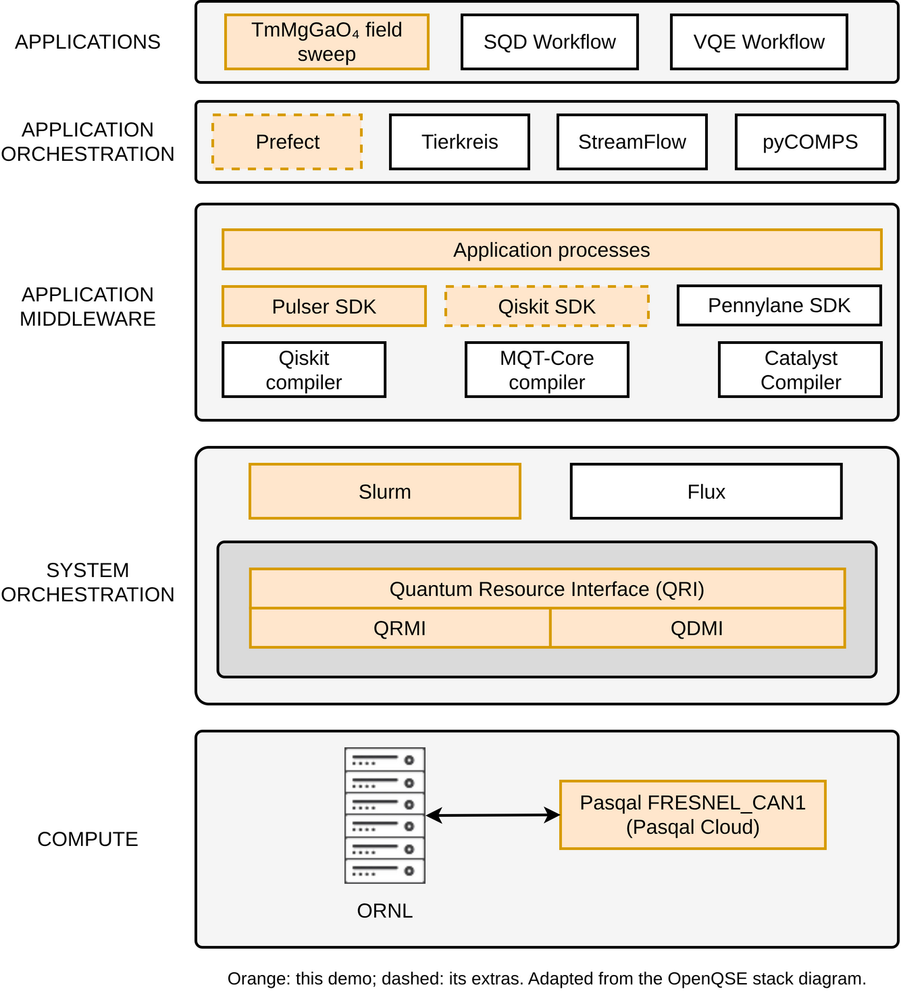
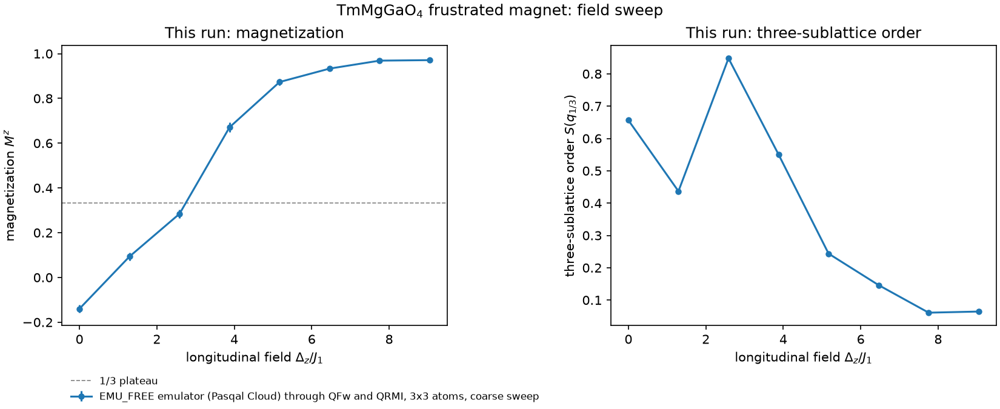
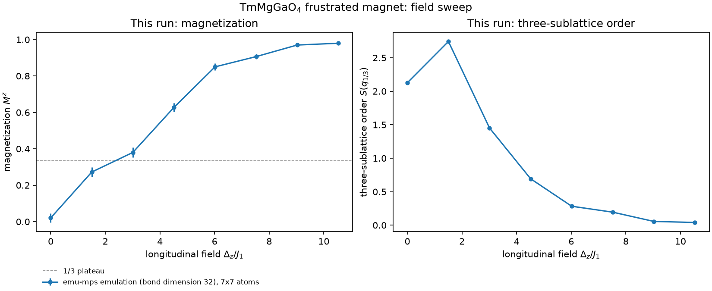

# A frustrated magnet on a Pasqal device, scheduled by Slurm through QFw

An OpenQSE demo for SC26: a material application runs as ordinary Slurm jobs, and
[QFw](https://github.com/openQSE/QFw) reserves the Pasqal device for the quantum step only.

The application follows Leclerc et al., "One-to-one quantum simulation of a frustrated
magnet with 256 qubits", [arXiv:2603.20372](https://arxiv.org/abs/2603.20372): Rydberg
atoms on a triangular lattice follow the Ising model of the magnet TmMgGaO4. The demo
sweeps the longitudinal field and measures the magnetization M^z and the three-sublattice
order S(q_1/3) that marks the 1/3 plateau, written in [Pulser](https://github.com/pasqal-io/Pulser).



The demo's path through the OpenQSE stack, adapted from the OpenQSE project's stack
diagram (source: `docs/openqse-stack.drawio`).

## How it runs

`./demo.sh` submits three Slurm jobs, each after the one before succeeded
(`sbatch --dependency=afterok`), and shows their progress in place:

| Job | Resources | Does |
| --- | --- | --- |
| prepare | 1 task | builds the atom register and the field sweep on the device's public specs |
| quantum | QFw heterogeneous job | QFw's QPM service on one node reserves the device; the sweep, on the other, runs through it via [QRMI](https://github.com/qiskit-community/qrmi) or QDMI |
| analyze | 1 task | computes M^z and S(q_1/3) per sweep point and plots them |

The device is never held while classical code runs, and a failed step cancels the rest.

## Run it

Needs Docker Compose, about 15 GB of disk, an amd64 host for the published cluster image
(on arm64, build the image as the cluster's README says), and a
[Pasqal Cloud](https://portal.pasqal.cloud) account in `~/.pasqal/config`:

```
username=<your username>
password=<your password>
project_id=<your project id>
```

Start the part of openQSE's [QFw-SLURM-Cluster](https://github.com/openQSE/QFw-SLURM-Cluster)
the demo uses, at the commit it is tested with (its README has the details):

```bash
git clone https://github.com/openQSE/QFw-SLURM-Cluster.git cluster
cd cluster && git checkout c054699
./do_configure.sh --prefix "$PWD/shared-dir" --image ghcr.io/openqse/qfw-slurm-cluster:20260503-v1.0
docker compose --env-file qfw-install.env up -d mysql slurmdbd slurmctld c1 c2
cd ..
```

Then set the cluster up and build QFw with the Pasqal packages in it, once, and run the demo:

```bash
./demo.sh setup
./demo.sh
```

`setup` is for a cluster started as above: on a cluster whose image already has QFw in
`/opt/openqse`, it stops and `./demo.sh` uses that QFw. The jobs run as the first user
with a Slurm account, under that account, or else as the first regular user (`sgrundy` on
the cluster above).

The default is 9 atoms (3x3; EMU_FREE takes at most 12), 8 sweep points x 100 shots on Pasqal
Cloud's free EMU_FREE emulator, about 4 minutes. The plot opens at the end; it and the job outputs land in
`results/<stamp>/`, the full log in `logs/`. This is an example:



Options go after `./demo.sh`:

| Option | Does |
| --- | --- |
| `--lib qdmi` | reach the device through QDMI instead of QRMI |
| `--device-id pasqal-fresnel-can1` | the sweep on the FRESNEL_CAN1 QPU, 7x7 atoms |
| `--refine 4` | after the sweep, run 4 more points around the S(q_1/3) peak in a second QFw job |
| `--points 12 --shots 500` | a finer sweep, more shots |

The curves are not meant to look like the paper's: 9 emulated atoms are the paper's
protocol at small scale, not its experiment: a 3x3 lattice has one bulk site, the other
eight are edges. Emulation reaches the QPU's 7x7 with emu-mps, in about an hour on one GPU,
but not the larger lattices where the material's behaviour shows; that is what the QPU is for.

### On the QPU

The sweep is built on FRESNEL_CAN1's published specs, so `--device-id pasqal-fresnel-can1`
runs the same pulses on the QPU, with a project that has QPU access, on 7x7 atoms as the
paper's smallest scan:

- **Layout.** The atoms sit 5.78 um apart, where the maximum Rabi frequency gives the paper's
  Delta_x/J1 = 1.08 and the detuning range reaches Delta_z/J1 from 0 to 10. That is not one of
  the device's calibrated 5 um layouts, so the QPU calibrates a layout for it first.
- **Shots.** The default is 800 in all (8 points x 100); `--refine 4` adds 400. The analysis
  uses the 3x3 bulk, as the paper does.
- **Queue.** The quantum job asks Slurm for 50 hours and waits for the QPU up to 48, then
  gives up; the partition must allow that (`sinfo -o "%P %l"`). The jobs
  carry on if `./demo.sh` is stopped, their output in `cluster/shared-dir/demo-results/<stamp>/`. If
  the job fails after submitting, check the batches in the [portal](https://portal.pasqal.cloud)
  before running again: the points that got results are saved in `record.json`.
- **Calibration.** The sweep uses the device's published amplitude and detuning range; the
  paper calibrated the Rabi frequency and the resonance before its runs, which costs shots.
  An offset in the resonance shifts the curves along Delta_z/J1.
- **Detection errors.** The analysis corrects for the published false-positive and
  false-negative rates (1.2 % and 8 % today); the emulator has none.

## Extras

`./demo.sh shell` opens a shell in the cluster with QFw activated, where these run:

- `extras/prefect/flow.py`: the same steps as a [Prefect](https://www.prefect.io) flow, each
  task a Slurm job.
- `extras/qiskit/tmgo_qiskit.py`: the sweep written in Qiskit, as one Pasqal HamiltonianGate
  per point compiled by [qiskit-pasqal-provider](https://github.com/qiskit-community/qiskit-pasqal-provider).

Each file starts with the commands that run it. `tmgo/tmgo.py sim` emulates the sweep on
your own machine with QuTiP or emu-sv, or emu-mps for larger arrays, in a venv with
pulser-simulation, emu-sv and emu-mps.
This is the QPU sweep, 7x7 atoms with FRESNEL_CAN1's detection errors, emulated with
`tmgo/tmgo.py sim --device-id pasqal-fresnel-can1 --emulator mps --out sim.json` and plotted
with `tmgo/tmgo.py analyze sim.json --plot sim.png`; its M^z follows the paper's 7x7 QPU scan:



After `scancel` of a running quantum job, kill its leftover QPM daemons before the next
run: `docker exec c1 pkill defwp; docker exec c2 pkill defwp`.

## License

The code (the scripts and Python files) is Copyright (c) 2026 Pasqal, under the Pasqal
Open-Source Software License (MIT-derived), see [LICENSE](LICENSE). All other material
(documentation and figures) is Copyright (c) 2026 Pasqal. All rights reserved, except
`docs/openqse-stack.*`, adapted from the OpenQSE project's stack diagram with its permission.
